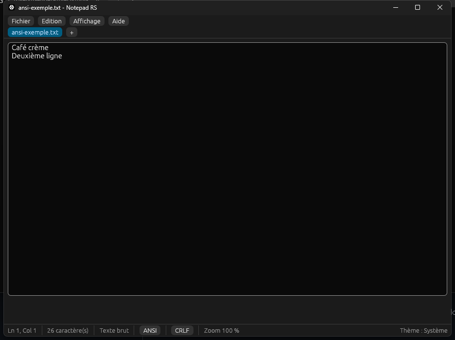
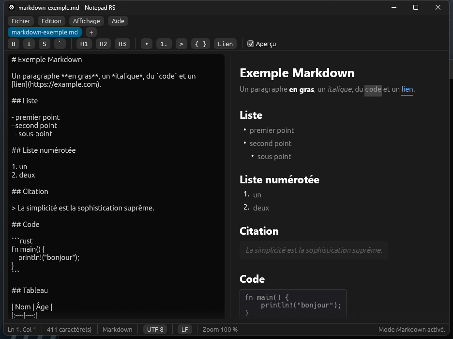

# Notepad RS

Reconstruction **native en Rust** des comportements du Bloc-notes Windows
(`C:\Windows\System32\notepad.exe`), déduits de preuves d'ingénierie inverse
collectées avec **REA** (provider Ghidra 12.1.4). Aucun code Microsoft n'est
réutilisé : seule l'observation du comportement a guidé l'implémentation.



Aperçu Markdown côte à côte avec la barre de mise en forme :



---

## 1. Preuves d'origine

| Élément | Valeur observée |
| --- | --- |
| Binaire analysé | `C:\Windows\System32\notepad.exe` |
| SHA-256 | `468ffe129c395abf6b21a09efdf261910a95fb98aa982ead73caa7b2b684577e` |
| Taille | 360 448 octets |
| Version | 10.0.26100.8875 (WinBuild.160101.0800) |
| Format / archi | PE32+ (AMD64), Win32 natif — pas la version WinUI du Store |
| Fonctions internes | 519 (plus 334 imports) |
| Imphash | `aa9e7e1bd35e47c6de05df960241a986` |
| DLL dominantes | `USER32` (87), CRT privée (39), `GDI32` (25), `COMCTL32` (11), `api-ms-win-core-*` |

Chaînes et ressources significatives retrouvées dans le binaire :

| Preuve | Ce qu'elle implique | Où c'est reproduit |
| --- | --- | --- |
| `Software\Microsoft\Notepad` | Clé de configuration de l'application | préférences portées par le document (voir limites) |
| `fWrap`, `fWrapAround` | Retour à la ligne + bouclage de la recherche | `Doc::wrap`, `FindState::wrap` |
| `lfFaceName`, `iPointSize` | Police et taille de police persistées (LOGFONT) | `Doc::font_size`, zoom |
| `DefaultFonts` | Polices par défaut par jeu de caractères | police proportionnelle par défaut |
| `Autosave` | Restauration de session | `session.rs` (JSON dans `%APPDATA%\notepad-rs`) |
| `IsTextUnicode` | Détection d'encodage à l'ouverture | `encoding::Encoding::detect` |
| `shell\osshell\accesory\notepad\notepad.cpp` … | Découpage interne (édition, fichiers, bannière, pré-rentrée) | séparation `doc` / `find` / `encoding` / `main` |
| `Microsoft.WindowsNotepad_8wekyb3d8bbwe` | Le binaire système n'est qu'un lanceur vers l'app Store | justifie une réimplémentation autonome |
| Ressource `EDPENLIGHTENEDAPPINFOID`, manifeste Common-Controls v6 | Intégration Windows (thèmes, protection EDP) | non applicable hors Win32 |

Les imports `SetMapMode`, `SetViewportExtEx`, `SetWindowExtEx` (GDI32) confirment
l'architecture de rendu texte historique : un contrôle d'édition Win32, une
police unique pour tout le document, pas de coloration syntaxique.

## 2. Périmètre reproduit

### Édition
- Éditeur multi-lignes, sélection, presse-papiers système (via `egui`/`arboard`).
- Annuler / rétablir avec fusion des frappes rapprochées (< 600 ms), 200 états
  max et plafond mémoire de 96 Mo.
- Insertion de l'heure et de la date (`F5`, format `%H:%M %d/%m/%Y`).
- Suppression de la sélection (`Supprimer`).
- Atteindre une ligne (1-based) avec validation des bornes.
- Enregistrement groupe (`Tout enregistrer`) : écriture directe quand le chemin
  est connu, dialogue pour les documents sans nom.

### Encodages (`encoding.rs`)
- Détection : BOM UTF-8 → UTF-16 LE → UTF-16 BE → validité UTF-8 → ANSI.
- Cinq choix, comme Notepad : ANSI, UTF-8, UTF-8 avec BOM, UTF-16 LE,
  UTF-16 BE — accessibles depuis la barre d'état.
- ANSI = **Windows-1252** via `encoding_rs` (page de code occidentale).
- Le changement de codage **réinterprète les octets d'origine** tant que le
  fichier n'a pas été modifié, comme le fait Notepad.

### Fins de ligne (`doc.rs`)
- Détection CRLF / LF / CR avec priorité au CRLF en cas d'égalité.
- Normalisation en `\n` en mémoire, réapplication du style d'origine à
  l'enregistrement.

### Recherche / remplacement (`find.rs`)
- Recherche avant / arrière, sensible ou non à la casse, avec bouclage
  (`fWrapAround`).
- Remplacement de l'occurrence courante et « Remplacer tout ».
- Recherche sur texte Unicode (frontières de caractères respectées).

### Markdown et mise en forme (`markdown.rs`, `format.rs`)
- **Aperçu latéral** 50/50 (`Ctrl+Maj+M` ou la case « Aperçu ») : titres,
  paragraphes, emphases (gras, italique, barré), code en ligne, blocs de code
  clôturés, listes à puces et numérotées, citations, tableaux avec alignement,
  règles horizontales, liens.
- Analyseur et rendu maison (aucune WebView) : les blocs sont convertis en
  `egui::LayoutJob`, le gras utilisant les familles grasses réellement
  installées.
- **Barre de mise en forme** affichée quand l'onglet est en Markdown : `B`, `I`,
  `S`, `` ` ``, `H1`–`H3`, `•`, `1.`, `>`, `{ }`, `Lien`.
- Les emphases sont des **bascules** : un second clic retire les marqueurs
  déjà posés autour de la sélection (ou compris dedans).
- Titres, listes, citations et blocs de code travaillent **ligne par ligne**
  (`format.rs`), en conservant l'indentation ; une sélection de plusieurs lignes
  est traitée en bloc.
- `{ }` agit sur le **bloc de code entier** : sélectionner son contenu, ou même
  une seule de ses clôtures, suffit à le retirer — jamais de clôture orpheline.
- La sélection est mémorisée quand un bouton de la barre prend le focus, et
  oubliée dès qu'on clique ou tape dans le texte.

### Mise en page et impression (`page.rs`, `print.rs`)
- Boîte **Mise en page** : papier (A4, Lettre, Legal, A5), orientation portrait
  ou paysage, marges en millimètres (19,05 mm par défaut, comme Notepad).
- **Aperçu avant impression** paginé, zoomable, avec pied de page
  « Page n / N » ; bouton d'impression directe depuis l'aperçu.
- Impression **GDI native** : boîte `PrintDlgW` de Windows, rendu de chaque page
  avec `StartDoc`/`StartPage`/`TextOut`, puis `EndDoc`.
- L'orientation et le format de « Mise en page » sont écrits dans le `DEVMODE`
  avant l'ouverture de la boîte : celle-ci affiche donc déjà « Paysage » ou le
  papier choisi, comme le Bloc-notes.
- La pagination d'impression reprend les dimensions réelles du pilote
  (`PHYSICALWIDTH/HEIGHT`, marges élargies si la zone non imprimable l'exige)
  pour ne rien dessiner hors de la feuille.

### Fichiers récents et session (`session.rs`)
- Menu `Fichier → Fichiers récents ▸` : 10 chemins maximum, le plus récent en
  tête, dédoublonnage insensible à la casse, `Effacer la liste`.
- Un fichier déjà ouvert n'est pas rouvert en double : l'onglet existant est
  activé.
- **Restauration de session** au démarrage : onglets (ordre, onglet actif,
  codage, fin de ligne, retour à la ligne, zoom, position du curseur), thème,
  police, barre d'état et taille de fenêtre.
- **Autosauvegarde** des documents modifiés (texte en clair dans le JSON, comme
  l'autosauvegarde du Bloc-notes) : reprise après un arrêt brutal, titre `*`
  conservé.
- Écriture différée (3 s après la dernière modification), atomique (fichier
  temporaire puis renommage) et à la fermeture.
- `--new-window` (`Nouvelle fenêtre`) démarre sans restaurer la session ;
  un fichier en argument ouvre une fenêtre neuve, sans restauration non plus.

### Interface
- Menus alignés sur le Bloc-notes 11 : **Fichier**, **Edition**, **Affichage**
  (+ Aide), avec `Nouvelle fenêtre`, `Tout enregistrer`, `Fermer la fenêtre`,
  `Supprimer`, `Rechercher suivant/précédent`, sous-menu `Zoom`, `Police...`.
- Onglets : création, fermeture (bouton du milieu ou menu contextuel) avec
  confirmation si modifié, **réordonnancement par glisser-déposer**.
- Menu contextuel d'onglet : `Fermer`, `Fermer les autres`, `Fermer les onglets
  à droite`, `Copier le chemin complet`, `Ouvrir l'emplacement`.
- Barre d'état : ligne/colonne, nombre de caractères, « Texte brut », codage et
  fin de ligne **cliquables** (menus déroulants), zoom, message de statut.
- Thème **Système / Clair / Sombre** (suit Windows par défaut), barre d'état
  masquable, retour à la ligne activable.
- Boîte **Police** : familles système réellement installées (fichiers de
  `C:\Windows\Fonts`, chargés à la demande) + taille en points.
- Zoom clavier (Ctrl +, Ctrl -, Ctrl 0), Ctrl + molette sur l'éditeur.
- Glisser-déposer de fichiers, ouverture par argument de ligne de commande
  (`notepad-rs.exe fichier.txt`).
- Multi-fenêtres : chaque fenêtre est un processus (`Nouvelle fenêtre`) ;
  `Quitter` demande la fermeture gracieuse des autres fenêtres (`WM_CLOSE`),
  chacune affichant son propre dialogue d'enregistrement.

### Raccourcis
`Ctrl+N` nouvel onglet · `Ctrl+Maj+N` nouvelle fenêtre · `Ctrl+O` ouvrir ·
`Ctrl+S` enregistrer · `Ctrl+Maj+S` enregistrer sous · `Ctrl+W` fermer l'onglet ·
`Ctrl+Maj+W` fermer la fenêtre · `Ctrl+Z` annuler · `Ctrl+Y` rétablir ·
`Ctrl+A` tout sélectionner · `Ctrl+F` rechercher · `F3` suivant ·
`Maj+F3` précédent · `Ctrl+H` remplacer · `Ctrl+G` atteindre · `F5` heure/date ·
`Ctrl+Maj+M` aperçu Markdown · `Ctrl+B` gras · `Ctrl+I` italique ·
`Ctrl+P` imprimer.

## 3. Architecture

```
src/
  main.rs      application eframe/egui : menus, onglets, éditeur, dialogues,
               historique annuler/rétablir, raccourcis, barre de mise en forme
  doc.rs       modèle de document : texte, chemin, codage, fin de ligne,
               retouche, ligne/colonne
  encoding.rs  détection, décodage et encodage ANSI / UTF-8 / UTF-16
  find.rs      recherche avant/arrière, bouclage, remplacement
  markdown.rs  analyseur Markdown et rendu `egui` (aperçu)
  format.rs    mise en forme ligne par ligne (titres, listes, citation, code)
  page.rs      mise en page, découpe des lignes, pagination partagée
  print.rs     impression GDI, boîte Windows, `DEVMODE`
  session.rs   persistance JSON : onglets, préférences, fenêtre, récents
```

Dépendances : `eframe`/`egui` 0.37 (fenêtre + rendu), `encoding_rs` (ANSI),
`rfd` (boîtes de dialogue natives), `chrono` (heure/date), `serde`/`serde_json`
(session), `windows-sys` (fermeture des autres fenêtres via `WM_CLOSE`,
impression GDI, `PrintDlgW`, `DEVMODE`).

## 4. Compilation

Prérequis (machine actuelle) :

| Outil | Version utilisée |
| --- | --- |
| Rust | toolchain `stable-x86_64-pc-windows-gnu` (rustc 1.99.1), override local |
| Linker | WinLibs GCC 16.2.0 (UCRT, POSIX) installé par winget |
| Cible | `x86_64-pc-windows-gnu` (fixée dans `.cargo/config.toml`) |

```powershell
# Depuis C:\Users\Gedge\Projects\notepad-rs
.\build.ps1              # cargo build
.\build.ps1 build -Release
.\build.ps1 test         # 111 tests
.\build.ps1 run
```

Binaire produit :
`target\x86_64-pc-windows-gnu\release\notepad-rs.exe`

Le binaire est une application de sous-système Windows
(`windows_subsystem = "windows"`, désactivé pour les tests) : aucune fenêtre de
console ne s'ouvre au lancement.

### Pourquoi `build.ps1` ?

`C:\MinGW\bin` (GCC 6.3, 32 bits) est présent dans le PATH **machine**, donc
avant WinLibs. Rust l'utilise pour `dlltool` et échoue avec
`Invalid bfd target` dès qu'il doit générer une import library 64 bits
(`raw-dylib`, utilisé par la crate `windows`). Le script préfixe le PATH du
**processus** avec le `bin` de WinLibs, sans modifier la configuration système.

Si vous préférez ne pas passer par le script :

```powershell
$env:PATH = "$env:LOCALAPPDATA\Microsoft\WinGet\Packages\BrechtSanders.WinLibs.POSIX.UCRT_Microsoft.Winget.Source_8wekyb3d8bbwe\mingw64\bin;$env:PATH"
cargo build --release
```

## 5. Tests

59 tests unitaires couvrent les parties vérifiables sans interface :

- encodages : détection BOM, UTF-8 sans BOM, repli ANSI, allers-retours
  UTF-16 LE/BE (y compris hors BMP) et Windows-1252 ;
- fins de ligne : détection, normalisation, application ;
- lignes/colonnes : index 1-based, recherche d'index de ligne ;
- recherche : casse, bouclage avant/arrière, remplacement global, texte
  multi-octets ;
- session : aller-retour JSON, tolérance aux champs inconnus/absents,
  dédoublonnage et plafond des récents, correspondance codage/fin de ligne,
  emplacement `%APPDATA%` ;
- Markdown : titres, emphases imbriquées, liens, code clôturé, listes, citations,
  tableaux alignés, échappements et `snake_case`, lignes repliées ;
- mise en forme : bascules titre / puce / numérotation / citation / bloc de
  code, conservation de l'indentation, sélection multi-lignes, bascule d'un bloc
  de code depuis une ligne intérieure ou depuis une seule clôture ;
- mise en page : papier et marges assainis, paysage, découpe des mots longs,
  pagination selon la hauteur utile et selon la feuille réelle du pilote.

```powershell
.\build.ps1 test
```

## 6. Limites connues

- **Sessions** : la fenêtre principale utilise `%APPDATA%\notepad-rs\session.json`.
  Une fenêtre lancée avec `Nouvelle fenêtre` utilise un fichier isolé nommé
  `session-window-<pid>.json` et ne peut pas écraser l'état de la fenêtre
  principale ; elle n'est volontairement pas restaurée au prochain démarrage.
- **Texte autosauvegardé en clair** dans `session.json` (comme l'autosauvegarde
  du Bloc-notes) : effacer ce fichier remet l'application à zéro.
- **Page de code** : ANSI utilise la page système Windows (`GetACP`), y compris les pages multioctets et UTF-8.
- **Conversion ANSI avec perte** : avant l'enregistrement, l'application détecte
  les caractères absents de la page ANSI système et demande une confirmation explicite.
- **Impression** : pagination approximative entre l'aperçu (dimensions de
  « Mise en page ») et l'imprimante (dimensions du pilote), un saut de page peut
  donc différer légèrement ; le texte est imprimé en police simple (le gras et
  l'italique Markdown ne sont pas rendus à l'impression). Les en-têtes et pieds de page personnalisés, la sélection, la plage de pages et le nombre de copies sont pris en charge.
- **Outils d'écriture IA et « Rechercher avec Bing »** volontairement hors
  périmètre.
- **Police** : catalogue des fichiers TTF/OTF et collections TTC/OTC dans les dossiers de polices Windows et utilisateur, variantes de style incluses. Les fontes uniquement enregistrées dans un emplacement personnalisé ne sont pas encore découvertes.
- **Fenêtres** : une fenêtre = un processus (pas d'onglets détachables ni de
  restauration de session multi-fenêtres). `Quitter` ferme les autres instances
  du même exécutable.
- **Fenêtre** : position, taille normale et état maximisé restaurés.
- **Fichiers volumineux** : le texte est chargé entièrement en mémoire et rendu
  par `egui`, sans le découpage incrémental de Notepad. Au-delà de quelques
  dizaines de Mo, l'ouverture et la saisie ralentissent.
- **Pas de coloration syntaxique ni de numérotation de lignes** — fidèle au
  Bloc-notes, mais aussi absence de modes additionnels.
- **Zoom** appliqué par document et non global à l'application.
- **Tests** : logique et événements egui automatisés ; dialogues système et lecteur d’écran à vérifier manuellement.

## 7. Journal des lots

- **Lot 1** (fait) : structure de menus du Bloc-notes 11, nouvelle fenêtre /
  fermer la fenêtre / quitter, tout enregistrer, supprimer, rechercher
  suivant/précédent (F3 / Maj+F3), sous-menu Zoom, boîte Police, thème système,
  codage et fin de ligne cliquables dans la barre d'état.
- **Lot 2** (fait) : fichiers récents, restauration de session et autosauvegarde,
  réordonnancement des onglets par glisser-déposer, menu contextuel d'onglet
  (fermer / fermer les autres / fermer à droite / copier le chemin / ouvrir
  l'emplacement), ouverture sans doublon, restauration du curseur.
- **Lot 3** (fait) : Markdown + aperçu latéral, barre de mise en forme, mise en
  page et impression GDI avec aperçu paginé.

## 8. Licence et provenance

Code original sous MIT. Les noms de valeurs de registre, chaînes et noms de
fonctions cités proviennent de l'analyse du binaire public de Windows et
servent uniquement de documentation comportementale.

La chaîne Rust du projet est définie dans `rust-toolchain.toml` : `stable-x86_64-pc-windows-gnu`. Cette configuration est conservée après un déplacement du dossier et évite de reprendre la chaîne MSVC par défaut (qui exige `link.exe`). Si nécessaire, installez-la avec `rustup toolchain install stable-x86_64-pc-windows-gnu`. Utilisez ensuite `build.ps1` pour sélectionner également WinLibs.


## Améliorations Bloc-notes — 26 octobre 2026

- ANSI : page de code Windows réelle, conversion sans approximation « best fit », confirmation explicite avant toute perte.
- Fenêtre : position, taille normale et état maximisé conservés.
- Paramètres > Préférences du Bloc-notes : ouvrir les fichiers dans un onglet ou une nouvelle fenêtre, désactiver ou vider les fichiers récents.
- Police : familles et variantes installées, collections de polices incluses ; tailles exprimées en pixels logiques.
- Barre d’état : ligne, colonne, total et « X sur Y caractère(s) » directement visibles.
- Recherche/remplacement : bornes Unicode corrigées pour les correspondances de casse de longueurs UTF-8 différentes.

Restent hors de ce lot : correction orthographique/automatique, routage d’une association de fichiers vers un processus déjà ouvert, onglets détachables, rendu incrémental des très gros fichiers et pagination strictement identique au pilote d’impression.
